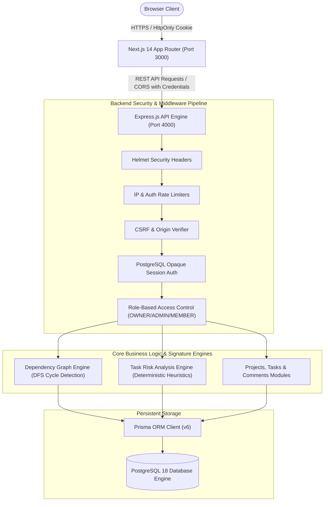

# WorkFlowX System Architecture Document

## 1. System Overview

**WorkFlowX** is a secure, full-stack team project management and task risk analysis platform designed for student engineering teams, startups, and agile organizations. The platform pairs traditional Kanban workflows with an intelligent, rule-based **Task Dependency & Risk Analysis Engine**.



---

## 2. Monorepo Structure

```
WorkFlowX/
├── apps/
│   ├── api/                     # Express.js REST API Server
│   │   ├── src/
│   │   │   ├── config/          # Environment validation (Zod), Prisma client
│   │   │   ├── middleware/      # Auth, RBAC, Validation, RateLimiter, CSRF, ErrorHandler
│   │   │   ├── modules/         # Auth, Teams, Projects, Tasks, Dashboard, Notifications, Activity
│   │   │   ├── routes/          # Versioned REST router (/api/v1)
│   │   │   ├── utils/           # Crypto, Logger, Response formatters
│   │   │   ├── app.js           # Express app setup and middleware pipeline
│   │   │   └── server.js        # HTTP server entry point and graceful shutdown
│   │   └── tests/               # Automated node:test + supertest integration suites
│   └── web/                     # Next.js 14 App Router Frontend
│       ├── app/                 # App Router pages (Dashboard, Projects, Board, Tasks, Auth, etc.)
│       ├── components/          # Reusable UI, Kanban board, Modals, Risk Badges, Layout
│       ├── context/             # AuthContext with active workspace switcher
│       └── lib/                 # Fetch API client wrapper
├── packages/
│   └── shared/                  # Common domain models, constants, risk logic, and cycle detection
├── prisma/
│   ├── schema.prisma            # PostgreSQL relational schema
│   ├── migrations/              # Immutable SQL migration history
│   └── seed.js                  # Realistic development seed dataset with 5 demo personas
├── docs/                        # Architecture, DB, API, Security, and Testing manuals
├── .env.example                 # Documented configuration template
└── package.json                 # Monorepo workspaces definition
```

---

## 3. Signature Features

### A. Directed Task Dependency Engine
- Tasks can specify prerequisite tasks (`predecessorTaskId -> successorTaskId`).
- **Graph Traversal & Cycle Detection**: Before persisting any dependency, the engine executes Depth-First Search (DFS) over existing project edges to detect if a path already exists from the successor to the predecessor. If detected, the transaction aborts with a 400 error and returns the exact cycle sequence (`A -> B -> ... -> A`).
- **Cascading Unblocking**: When a prerequisite task is marked `DONE`, the system queries downstream successor tasks. If all prerequisites for a downstream task are resolved, the task automatically transitions from `BLOCKED` to `TODO` and dispatches notifications.

### B. Transparent Rule-Based Risk Engine
Unlike arbitrary "black-box" prediction, WorkFlowX evaluates a deterministically calibrated multi-factor scoring rubric:
1. **Overdue Status**: `dueDate < now` and `status != DONE` (+50 points, HIGH risk).
2. **Impending Deadline**: Remaining hours <= 24h (+35 points) or <= 72h (+20 points).
3. **Incomplete Prerequisites**: One or more prerequisites remain unfinished (+25 points).
4. **Overdue Prerequisites**: Prerequisite passed its deadline without completion (+40 points, compounding delay).
5. **Directly Blocked**: Task explicitly flagged as `BLOCKED` (+20 points).
6. **Assignee Overload**: Developer is concurrently assigned > 4 active deliverables (+15 points).
7. **Effort vs Time Gap**: `estimatedHours > hoursRemaining` (+25 points).
8. **Blast Radius**: Task has >= 3 downstream dependents (+15 points).

The engine outputs:
- `riskLevel`: LOW, MEDIUM, or HIGH
- `reasons`: Explicit explanations array
- `affectedDownstreamCount`: Number of affected successors
- `recommendedAction`: Actionable guidance for managers and developers
