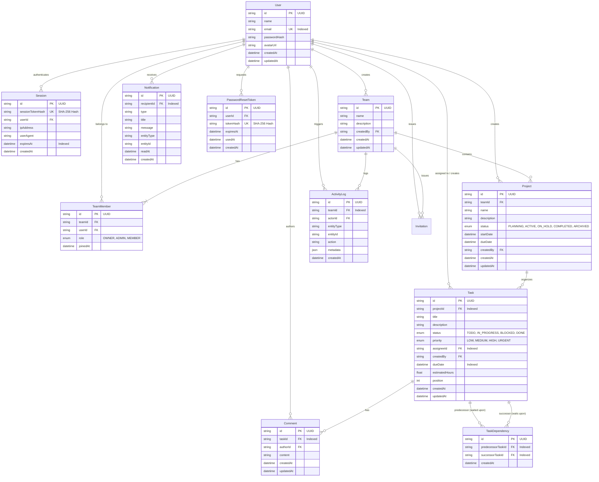

# WorkFlowX Database Design Document

## 1. Entity Relationship (ER) Diagram



---

## 2. Relational Constraints & Integrity Guarantees

1. **Unique Team Membership**: `@@unique([teamId, userId])` prevents duplicate memberships in the same workspace.
2. **Unique Task Dependencies**: `@@unique([predecessorTaskId, successorTaskId])` prevents redundant edges in the dependency graph.
3. **Cascade Deletions**:
   - Deleting a team cascades its members, projects, and invitations.
   - Deleting a project cascades its tasks and dependencies.
   - Deleting a task cascades its comments and dependency relationships.
4. **Referential Integrity for Audit Trail**:
   - `ActivityLog` entries reference actor and team; team deletion cleanly cascades audit records.

---

## 3. Indexing Strategy

- **`User(email)`**: Fast B-tree index for O(1) login lookups.
- **`Session(sessionTokenHash, expiresAt)`**: Immediate hash lookup for session authorization and cleanup of expired tokens.
- **`Task(projectId, status, priority, assigneeId, dueDate)`**: Composite and single-column indexes for high-speed Kanban filtering, dashboard aggregates, and deadline queries.
- **`TaskDependency(predecessorTaskId, successorTaskId)`**: High-speed traversal during cycle detection and downstream blast radius evaluation.
- **`Notification(recipientId, readAt)`**: Instant unread badge counts and notification queries.

---

## 4. Backup & Recovery Guidance

### Periodic Backup via `pg_dump`
```bash
pg_dump -U postgres -h localhost -d workflowx_dev -F c -b -v -f "workflowx_backup_$(date +%Y%m%d_%H%M%S).dump"
```

### Restoration via `pg_restore`
```bash
pg_restore -U postgres -h localhost -d workflowx_dev -v "workflowx_backup_YYYYMMDD_HHMMSS.dump"
```
